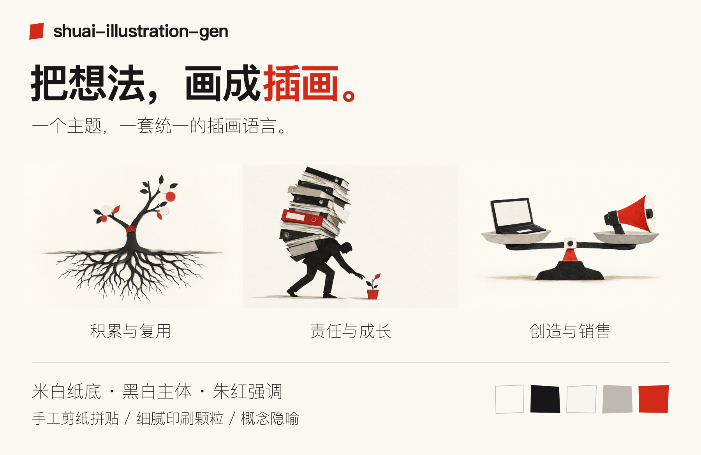

# shuai-illustration-gen



生成风格统一的复古编辑概念插画：暖米白纸底、黑白灰主体、朱红强调、手工剪纸拼贴与细腻印刷颗粒。

适合文章配图、抽象概念表达和系列插画。风格规范全部写在 [SKILL.md](SKILL.md) 中，无需附带或读取固定参考图片。

## 安装

将仓库克隆到支持 Agent Skills 的工具所读取的技能目录，例如：

```bash
git clone https://github.com/qizong007/shuai-illustration-gen.git ~/.agents/skills/shuai-illustration-gen
```

目标目录已存在时，先检查现有安装，避免覆盖。使用其他技能目录的工具，可调整克隆位置。

## 使用

```text
用 $shuai-illustration-gen 画一张表达「注意力被分散」的插画。
```

也可以提供文章或段落，指定画幅、数量或仅输出提示词。默认生成一张横向 3:2 无字插画；实际出图需要环境提供图像生成工具，Codex 中优先使用内置 image_gen。

## 视觉规范

| 用途 | 目标色 |
| --- | --- |
| 米白背景 | `#FBF8F1` |
| 主黑色 | `#171717` |
| 纸张白 | `#F7F5EF` |
| 辅助灰 | `#BDB9B0` |
| 强调红 | `#D32918` |

红色可以覆盖完整主题形体，或在相关纸片间呼应；不按固定面积机械补色。整体保持黑白灰结构、充足留白和轻微纸张层次。HEX 是生成目标，不代表逐像素色彩保证。
